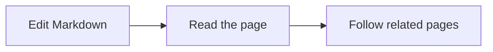

# Markdown Reader

The reader renders ordinary Markdown. Choral Forma does not require proprietary page syntax for the common cases shown here. For a page that leans more heavily on internal references, compare [[notes/connect-pages|Connect Pages]]. The completed editor-link validation is tracked in [[tasks/validate-editor-link-navigation|Validate Editor Link Navigation]].

## Inline Text

Paragraphs can include **strong text**, _emphasized text_, `inline code`, ~~strikethrough text~~, and external links such as [CommonMark](https://commonmark.org/).

Long inline values should wrap naturally, including paths such as `examples/getting-started-workspace/notes/markdown-reader.md`.

## Lists

- Keep notes short and scannable.
- Link related pages when the relationship matters.
  - Nested lists are useful for examples and checklists.
  - Inline code such as `.forma.md` should remain readable.

1. Edit Markdown files in your normal editor.
2. Run the local Forma server.
3. Refresh the WebApp.

- [x] Read the getting-started guide
- [ ] Try it on a small local workspace

## Blockquote

> Repository Markdown remains the source of truth. The WebApp should explain it without creating hidden application state.

## Code Blocks

```sh
cargo run -p forma-cli -- --workspace examples/getting-started-workspace serve
```

```ts
const workspaceMode = "read-only";
const sourceOfTruth = "repository-markdown";
```

## Table

| Markdown feature | Reader behavior                 | Example use            |
| ---------------- | ------------------------------- | ---------------------- |
| Links            | Clickable page navigation       | Connect related notes  |
| Code             | Syntax-highlighted code blocks  | Commands and snippets  |
| Tables           | Horizontally scrollable if wide | Compact comparisons    |
| Images           | Kept inside the reader column   | Product or guide media |

## Image

Images can live beside the Markdown files and be referenced with ordinary relative paths.


The image above is an ordinary image. Forma does not add an image preview, fullscreen button, or zoom gestures. An author can make an image a link explicitly:

[](./connect-pages.md)

## Reading Notes

Footnotes keep supporting detail out of the main paragraph[^reading-note]. A second call can refer to the same note[^reading-note]; each call has its own return destination in the WebApp and static reader.

Follow a [heading link to the image section](#image), or open [[notes/connect-pages|Connect Pages]] to continue exploring page navigation. Forma also provides readable heading aliases in the WebApp and static site while retaining existing reader links. VS Code keeps its native heading IDs.

[^reading-note]: Markdown source remains the editable content. A footnote can contain **emphasis** and ordinary links.

    This second paragraph belongs to the same footnote.

## Callouts

The five supported type names are case-insensitive. A title can follow the marker on its first line; otherwise the default title is used. Keep an empty quoted line between the header and body so formatters preserve their meaning:

> [!note] Reading context
>
> Keep supporting context close to the text it explains.

> [!TIP]
>
> Use relative links when connecting pages in this workspace.

> [!IMPORTANT]
>
> Markdown files and explicit configuration own the content.

> [!WARNING]
>
> Check which resources are included before sharing a static export.

> [!CAUTION]
>
> Keep credentials and private material out of content intended for sharing.

A callout can also contain only a title:

> [!tip] Remember to review the source

Add `-` immediately after the type marker to start collapsed, or `+` to start expanded:

> [!note]- Optional context
>
> Open the summary to read this detail. It also works in a static export without JavaScript.

> [!tip]+ Visible suggestion
>
> This starts open and can be collapsed using its summary.

Additional Obsidian types and aliases, and complex nesting are outside this supported subset. Ordinary blockquotes remain ordinary blockquotes, and code examples stay literal:

```markdown
> [!NOTE]
>
> This is a syntax example inside a code block.
```

## Diagrams



In the WebApp and enhanced static site, use Fit and Expand to inspect a diagram. Ctrl/Command-wheel or trackpad pinch zooms; keyboard plus/minus zooms, arrows pan, and zero or Home fits. Escape closes expanded inspection and returns focus to Expand. The toolbar leaves room for the fitted content on its right.

## Reader Hosts

The WebApp and static site share heading aliases, footnotes and the five basic callout types. Without JavaScript, the static site keeps ordinary images, authored links, footnotes and callout content readable; Mermaid remains source code. Rich presentation can differ between hosts.

VS Code uses its native Markdown engine. Forma keeps Frontmatter folding, workspace-reference navigation and configured View projections; it adds no footnote parser, heading aliases, image viewer, callout renderer or Mermaid renderer there. Callouts can remain ordinary blockquotes, and other extension syntax follows the host's capabilities.

When you are done here, jump back to [[notes/welcome-to-choral-forma|Welcome to Choral Forma]] or continue to [[notes/saved-views|Saved Views]].
