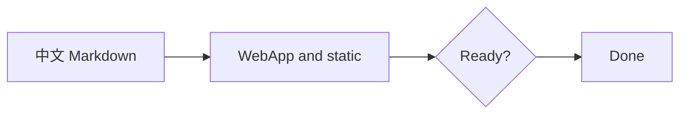
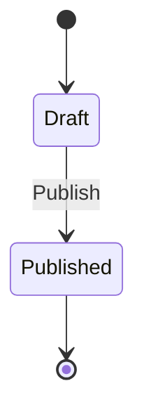
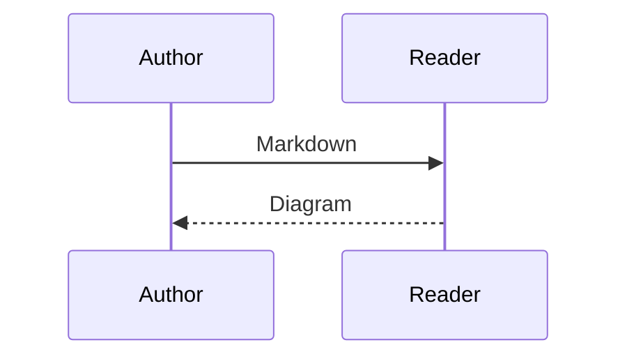
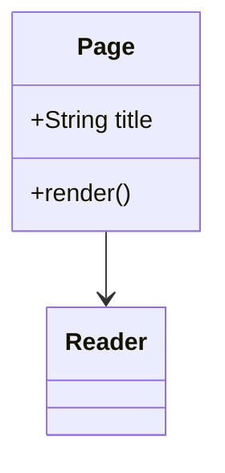
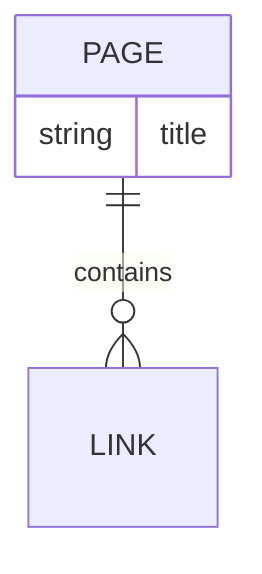
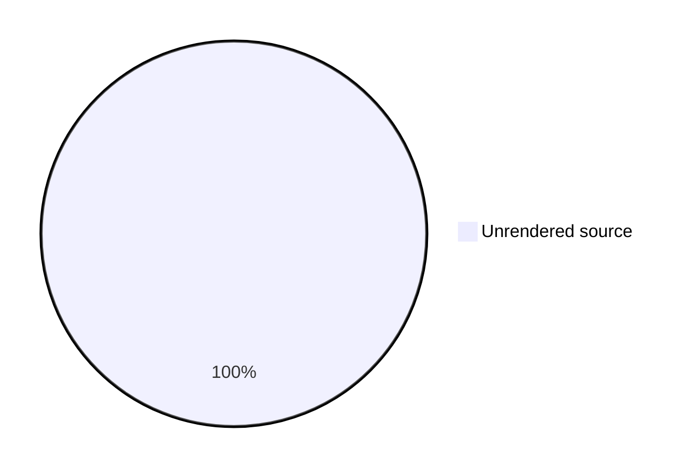

# Mermaid renderer acceptance

## Flowchart



## State



## Sequence



## Class



## Entity relationship



## Empty class

```mermaid
classDiagram
%% An empty class diagram remains an accessible empty figure with source.
```

## Unsupported diagram


