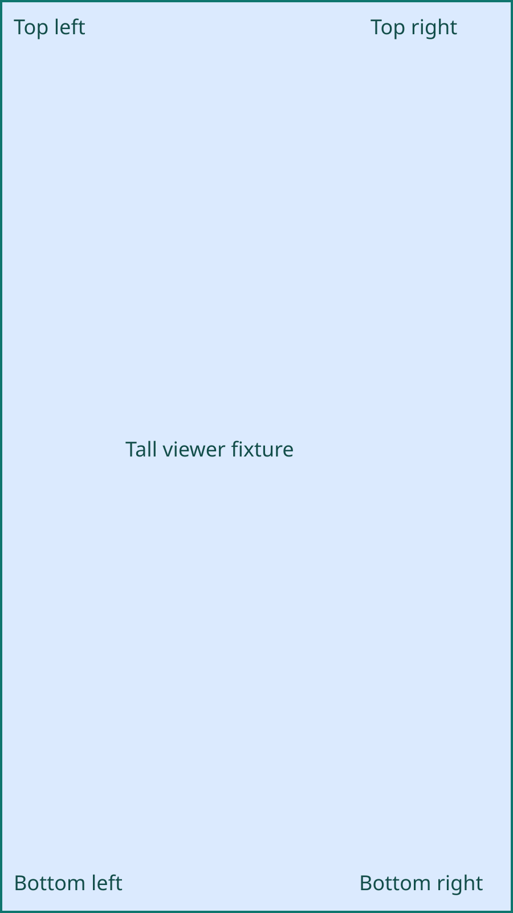
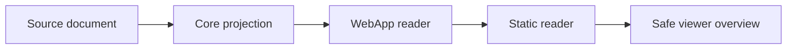
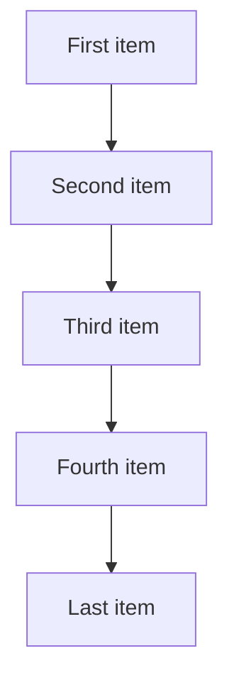

# Shared viewer inspection

## Wide image

## Tall image

## Linked image

## Wide Mermaid

## Tall Mermaid

Mermaid fit must show all diagram content to the left of the right control rail. Expand, zoom, resize, fit and Escape must retain the same controls and return focus to the opener. Images render normally and image links keep their authored destinations. Without scripts, Mermaid stays code and images remain ordinary images.
